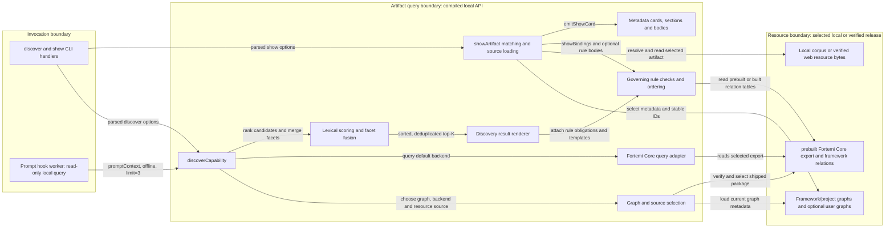

# Discovery internals

[Architecture](index.md) · [Discover/show sequence](flow-discover-show.md)

This page explains candidate selection, ranking and drill-ins. The existing
[index and manifest loading reference](../index-and-manifest-loading.md) owns
storage layouts, graph configuration and manifest merging; do not duplicate
those configurations when adding a discovery capability.

## Component view

Drawn from:

- [`src/cli/handlers/subcommands-discovery.ts`](../../../src/cli/handlers/subcommands-discovery.ts): `discoverHandler`, `showHandler`.
- [`src/artifacts/query-engine-discover.ts`](../../../src/artifacts/query-engine-discover.ts): `discoverCapability`.
- [`src/artifacts/query-engine-entries.ts`](../../../src/artifacts/query-engine-entries.ts): `defaultCapabilityGraphs`, `prepareProjectCapabilityIndex`, `compareDiscoverResults`, `dedupeDiscoverResults`.
- [`src/artifacts/fortemi-core-query-adapter.ts`](../../../src/artifacts/fortemi-core-query-adapter.ts): `loadFortemiCoreMetadataEntries`, `queryFortemiCoreAiwgDiscovery`.
- [`src/artifacts/relations.ts`](../../../src/artifacts/relations.ts): `selectPrebuiltRelations`, `loadBuiltRelations`.
- [`prebuilt/fortemi-core/`](../../../prebuilt/fortemi-core/), [`prebuilt/framework-relations/`](../../../prebuilt/framework-relations/): shipped export and relationships.
- [`src/artifacts/query-engine-scoring.ts`](../../../src/artifacts/query-engine-scoring.ts): `tokenize`, `scoreEntryDetailed`.
- [`src/artifacts/discover-facets.ts`](../../../src/artifacts/discover-facets.ts): `diagnoseFacetActivations`, `applyFacetFusion`.
- [`src/artifacts/query-engine-discover-output.ts`](../../../src/artifacts/query-engine-discover-output.ts): `emitDiscoverResults`.
- [`src/artifacts/query-engine-show.ts`](../../../src/artifacts/query-engine-show.ts): `showArtifact`.
- [`src/artifacts/query-engine-show-load.ts`](../../../src/artifacts/query-engine-show-load.ts): `loadShowEntries`, `resolveMetadataPath`.
- [`src/artifacts/query-engine-show-card.ts`](../../../src/artifacts/query-engine-show-card.ts): `emitShowCard`, `showSections`, `showResources`.
- [`src/artifacts/query-engine-rules.ts`](../../../src/artifacts/query-engine-rules.ts): `compoundGoverningRules`, `showBindings`, `ruleOrderingFields`.

## Sources and freshness

Default capability discovery selects framework and project graphs, plus eligible
user graphs when project policy permits them. A codebase graph is not simply
concatenated into every capability query; explicit graph selection and legacy
fallbacks are separate cases. Provenance records the graph and scope.

Fortemi Core is the default backend. Shipped `prebuilt/` exports and relationship
tables are checked against source identity. A valid prebuilt relationship package
avoids a redundant framework rebuild in the default path. Otherwise ordinary
queries may refresh framework capability metadata and prepare a missing project
index. Stale derived caches can fall back to current local metadata with warnings;
they are not silently treated as current scores.

`--backend local` retains the local metadata path. Resource source defaults to
`local`; `auto` selects local when available, otherwise web. Web discovery requires
the Fortemi Core backend and currently supports the framework graph. Release
resolution supplies verified paths, sizes and digests; `--offline` constrains
resource retrieval. Ordinary queries and the hook do not have identical write
contracts: `promptContext` or `noBuild` forces read-only selection, and prompt
context also forces the local backend and source.

## Ranking

`scoreEntryDetailed` normalizes tokens, removes stopwords and scores metadata
fields with coverage diagnostics. Exact names have a 1.001 floor; near-name or
recognized contained-name matches have a 0.951 floor. Field matches, trigger
coverage, verbose-query weighting and persona-facet suppression affect other
scores. Scores express ranking signals, not calibrated probabilities.

The strict lexical pass uses Fortemi scores scaled by 0.2 only when a candidate
has no lexical score. If any strict lexical results exist, that strict set drops
the Fortemi-only candidates. A relaxed lexical pass then contributes partial
matches above 0.02. The engine unions those paths, applies curated facet fusion,
deduplicates and truncates to `limit` (default five). This order matters: truncating
before facet fusion could hide the capability that owns the requested feature.

## Cards and governing rules

`showArtifact` matches stable IDs, paths and names via `findShowMatches`. Ambiguous
results exit two unless `--first` selects the first. Local corpus fallback can
still show an unindexed artifact with installation guidance. Bodies resolve from
the canonical source, not blindly from a provider mirror.

`emitShowCard` defaults to metadata, outline, resource hints and run hints.
`--section` and `--body` request content explicitly. `showBindings` and
`compoundGoverningRules` combine relationships with applicable rule activation
and ordering. `--rules --with-rule-bodies` fetches governing instructions;
statistics and summaries alone do not fulfill those obligations. Template
relationships provide further `show template` drill-ins.
