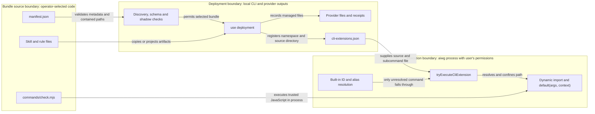

# Extending the CLI

Add a project bundle when a team needs its own skill, rule or CLI namespace.
Start with this guide, then use the existing [extension overview](../../extensions/overview.md),
[artifact types](../../extensions/extension-types.md),
[project-local quickstart](../../customization/project-local-quickstart.md) and
[manifest reference](../../project-local/manifest-reference.md) for detailed contracts.

## Choose a bundle type

| Type | Use it for | Type configuration |
|---|---|---|
| `extension` | A focused capability or small set of skills/rules | `extensionConfig` may be omitted |
| `addon` | An optional, installable collection with inventories and optional CLI modules | `addonConfig` |
| `framework` | A lifecycle/domain collection with context contributions and structured content | `frameworkConfig` |
| `plugin` | A delivery wrapper around an addon, framework or extension payload | `pluginConfig` with payload type/path |
| `provider` | A project selector extending a known provider's layout/capabilities | `providerConfig` with `extends`; select with `--provider` |

A skill's instructions, a provider slash-command projection, and a Node CLI module
are different execution surfaces. A skill becomes executable by `aiwg run skill`
only when it declares `script`. Use an addon `cli_commands` namespace for
`aiwg <namespace> <subcommand>`. Provider bundles do not become artifact payloads.

## Manifest contract

[`BundleManifestSchema`](../../../src/extensions/manifest.ts) is the executable
source of truth for project-local manifests. It is a **strict object**, requires
`manifestVersion: "1"`, and aligns `type` with exactly one matching configuration
block. An extension alone may omit its config block. Do not add arbitrary fields.

Required metadata includes `id`, `type`, `name`, `version`, `description`,
`platforms`, nonempty `keywords` and `deployment`. The discovery reader enforces a
64 KiB manifest limit and a 200-bundle cap; the schema limits keywords to 50 and
overrides to 20. Individual lists have their own caps (for example 500 skills,
200 rules and 50 hooks). These are validation limits, not execution isolation.

`CliCommandsSchema` describes a namespace, description, optional `entry` directory
(default `commands/`), and a nonempty subcommand map. Each subcommand declares
`file`, `description` and optional `hook_event`. Use a **local basename `.mjs` file**:
the schema's path grammar admits nested module paths, but registration currently
requires a basename. Neither entry paths nor relative source paths may contain
`..`. The worked example uses the supported intersection of those contracts.

## Where bundles live

- Canonical shipped sources: `agentic/code/{extensions,addons,frameworks}/`.
  Packaged plugin copies live under `agentic/code/plugins/`.
- Project sources: the resolved artifact root's
  `{extensions,addons,frameworks,plugins,providers}/<id>/`. By default this means
  `.aiwg/<type-directory>/<id>/`.
- Extra roots: `projectLocal.searchPaths` in project config, then
  `AIWG_PROJECT_LOCAL_PATHS` (OS path-delimited). Each root contains the same type
  directories. The artifact root is scanned first; roots are deduplicated.
- User scope: `aiwg use <name> --scope user` installs supported user assets and
  records the bundle in the user catalog. The external-bundle path also keeps
  project wiring. User-provider directories vary; consult
  [provider deployment](provider-deployment.md) before selecting a scope.

[`project-local-paths.ts`](../../../src/extensions/project-local-paths.ts) owns
search-root resolution. [`project-artifacts.ts`](../../../src/config/project-artifacts.ts)
owns artifact-root overrides. Do not infer the artifact directory from the
provider's `.claude/`, `.codex/` or other output directory.

## Loading and trust boundary



Drawn from:

- [`src/extensions/manifest.ts`](../../../src/extensions/manifest.ts): `BundleManifestSchema`, `CliCommandsSchema`.
- [`src/extensions/project-local-discovery.ts`](../../../src/extensions/project-local-discovery.ts): `discoverProjectLocalBundles`.
- [`src/extensions/shadow-resolver.ts`](../../../src/extensions/shadow-resolver.ts): `resolveShadows`.
- [`src/cli/handlers/use.ts`](../../../src/cli/handlers/use.ts): `deployOneProjectLocalBundle`, `registerSourceCliCommands`.
- [`src/cli/cli-extension-loader.ts`](../../../src/cli/cli-extension-loader.ts): `registerCliCommands`, `tryExecuteCliExtension`.
- [`src/cli/cli-extension-paths.ts`](../../../src/cli/cli-extension-paths.ts): `portableCliExtensionSource`, `resolveCliExtensionSource`.
- [`src/cli/router.ts`](../../../src/cli/router.ts): `run` built-in resolution before fallthrough.

**Only install bundles you trust. CLI modules run in the AIWG process with the
user's permissions and no sandbox.** They can access the filesystem, environment
and network available to that process. Path checks constrain module selection;
they do not restrict what imported JavaScript does. Review modules and their imports.

Built-in command IDs **and aliases always take precedence** over bundle namespaces.
Choose a distinct namespace. Contributed modules receive `(args, context)`;
context contains `cwd`, `frameworkRoot`, `namespace` and `subcommand`. Return
`{exitCode, message?}`; a missing result is treated as success. The router displays
the message. `FeatureComplete` is a deliberate action and is not auto-registered
as a Claude background hook. Other declared supported hook events can be registered
by the Claude deployment path. Extension execution uses its own router fallthrough,
not the built-in pre/post-command hook sequence.

## Worked example

Prerequisites: built or installed AIWG 2026.11.x, Node 24+, a clean project with
the default `.aiwg/` artifact location. These commands create a skill, a rule and
one CLI subcommand without modifying AIWG source. The headless `init` creates baseline config and canonical context before deploying.
Installed packages include framework discovery data. When using a source checkout,
prepare its shared framework index first from the installation root:
`(cd "$AIWG_ROOT" && aiwg index build --graph framework --force)`.

```bash
mkdir demo-project
cd demo-project
aiwg init --providers claude --yes
node --input-type=module <<'NODE'
import { mkdirSync, writeFileSync } from 'node:fs';
const root = '.aiwg/addons/demo-cli';
for (const dir of ['skills/demo-hello/scripts', 'rules', 'commands']) {
  mkdirSync(`${root}/${dir}`, { recursive: true });
}
const manifest = {
  id: 'demo-cli', type: 'addon', name: 'Demo CLI', version: '1.0.0',
  description: 'A local skill, rule and CLI namespace', manifestVersion: '1',
  platforms: { claude: 'full' }, keywords: ['demo', 'hello'],
  deployment: { pathTemplate: '.{platform}/skills/{id}.md' },
  core: false, autoInstall: false,
  skills: ['demo-hello'], rules: ['demo-rule'], agents: [], commands: [],
  addonConfig: { entry: { skills: 'skills/', rules: 'rules/' } },
  cli_commands: {
    namespace: 'demo-cli', description: 'Demo project commands', entry: 'commands/',
    subcommands: { ping: { file: 'ping.mjs', description: 'Echo an argument' } }
  }
};
writeFileSync(`${root}/manifest.json`, JSON.stringify(manifest, null, 2) + '\n');
writeFileSync(`${root}/skills/demo-hello/SKILL.md`, `---
name: demo-hello
description: Print a local demo greeting
script:
  entrypoint: scripts/hello.mjs
  runtime: node
  cwd: project-root
---
# Demo hello
Run the declared script to print a greeting from the current project.
`);
writeFileSync(`${root}/skills/demo-hello/scripts/hello.mjs`,
  'console.log("Hello " + (process.argv[2] ?? "project"));\n');
writeFileSync(`${root}/rules/demo-rule.md`, `---
name: demo-rule
enforcement: low
activation: bound
bound_to:
  skills: [demo-hello]
summary: Keep demo output brief.
---
# Demo rule
Keep demo output brief.
`);
writeFileSync(`${root}/commands/ping.mjs`,
  'export default async (args, ctx) => ({ exitCode: 0, message: ctx.namespace + ":" + args.join(",") });\n');
NODE
aiwg use demo-cli --provider claude --no-utils --no-hooks
aiwg run skill demo-hello -- reader
aiwg demo-cli ping hello
aiwg doctor --project-local
```

The skill prints `Hello reader`; the namespace prints `demo-cli:hello`. The provider
receives the skill and rule; the `.mjs` command executes from its source directory.
Doctor should report valid manifests and no missing CLI source warning. Deployment
also refreshes the project capability graph, so `aiwg discover "demo hello"` can
find the skill. Re-run `use` after changing the manifest or adding an entrypoint.

For scaffolding instead of manual files, start with
`aiwg new-bundle demo-cli --type addon --starter skill`, then edit its generated
manifest and artifacts. Do not run that on top of the example directory: existing
bundles are deliberately not overwritten.

## Portable CLI registration

`aiwg use` calls `registerCliCommands` to write `cli-extensions.json` beneath the
resolved artifact root. Sources **inside the project** are written relative to
the project working directory, for example:

```json
{
  "demo-cli": {
    "source": ".aiwg/addons/demo-cli/commands",
    "description": "Demo project commands",
    "subcommands": { "ping": { "file": "ping.mjs", "description": "Echo an argument" } }
  }
}
```

The base is the **project root, not the registry's parent**. This stays true with
an external artifact root. Sources outside the project remain absolute, including
sources in an external artifact root. Re-run `aiwg use <bundle>` on each machine
for those sources. Existing absolute registrations keep loading. Relative sources
reject `..` segments and symlink escapes; module files must stay in their source
directory. This is confinement of the selected path, not isolation of the module.

A committed registry is portable only if its source directories are available in
the clone. `aiwg doctor --project-local` warns about missing sources even when no
bundle directories remain. It does not rewrite the registry or execute modules.

## Removal and promotion

Preview and remove a deployment with `aiwg remove demo-cli --dry-run`, then
`aiwg remove demo-cli`. Removal preserves project-local source and checks deployed
hashes before reverting or retaining edited outputs. See the
[lifecycle guide](../../customization/project-local-lifecycle.md) for precise cases.

CLI namespace registration is a separate file: current removal does not delete
its entry. To retire a namespace, remove its key from `cli-extensions.json` and
remove any separately registered hook command after reviewing provider settings.
Deleting bundle source alone leaves a stale registration that doctor warns about.

Preview promotion with `aiwg promote demo-cli --dry-run`. `aiwg promote demo-cli`
copies the unchanged bundle shape to upstream; `--to corpus <path>` targets a
private corpus, and `--cleanup` removes local source after successful promotion.
Promotion verifies hashes and scans project-local references. See the existing
[lifecycle guide](../../customization/project-local-lifecycle.md) rather than
changing deployment receipts by hand. Register CLI commands again after moving
their source.
