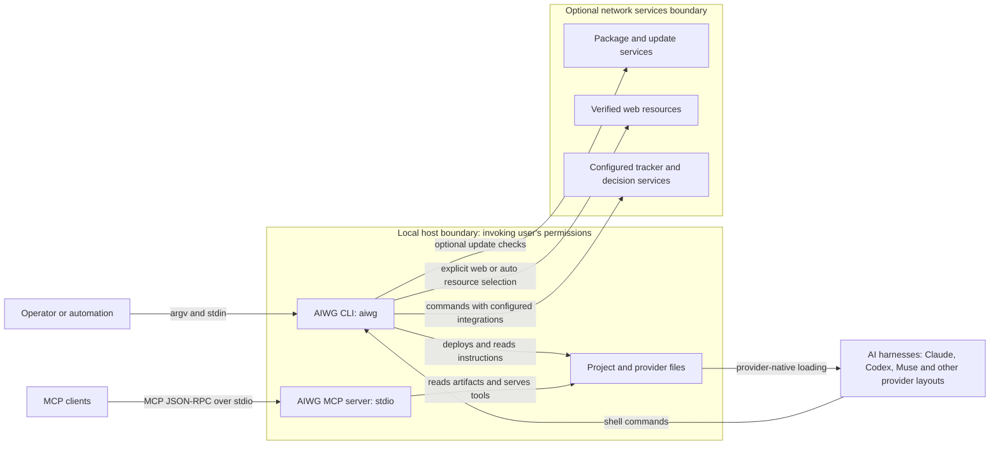
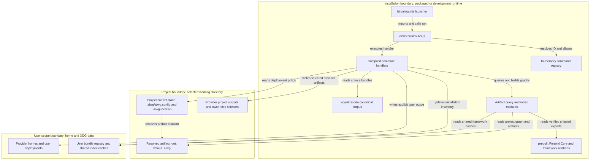
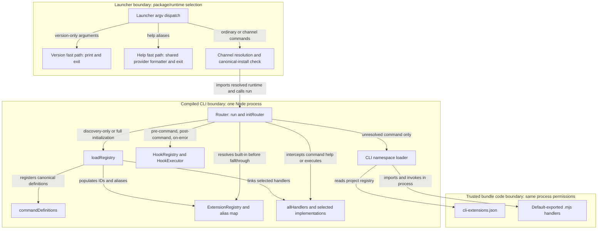

# AIWG CLI architecture

Current for **2026.11.x**, checked against the source in this checkout. This is
an arc42-style map of the CLI, using Mermaid flowcharts for C4 views so the
source renders in both GitHub and Gitea. The [user walkthrough](../../how-it-works.md)
and [kernel/discovery guide](../../discovery-and-kernel-skills.md) explain the
operator experience.

## Goals and constraints

AIWG delivers reusable instructions to existing AI harnesses and exposes optional
runtime tools. The CLI should start quickly for discovery, use one provider
registry for layouts, preserve operator files, and let projects add capabilities
without modifying the built-in router. It runs on Node.js 24 or newer.

A deployment is primarily files plus receipts. No server is required for ordinary
`use`, `discover`, `show`, or local script dispatch. MCP and configured remote
resources are separate surfaces. Source modules, bundle modules and skill scripts
execute with the invoking user's permissions; path validation is not a sandbox.

## Context: who uses AIWG?

Drawn from:

- [`bin/aiwg.mjs`](../../../bin/aiwg.mjs): `main`, update notification bootstrap.
- [`src/providers/provider-definitions.ts`](../../../src/providers/provider-definitions.ts): `PROVIDER_IDS`, `listProviderDefinitions`.
- [`src/mcp/server.mjs`](../../../src/mcp/server.mjs): `createServer`, `startServer`.
- [`src/resources/web-release.ts`](../../../src/resources/web-release.ts): web release resolution.
- [`src/cli/handlers/decision.ts`](../../../src/cli/handlers/decision.ts): `decisionAsk`.
- [`src/issues/audit-cli.ts`](../../../src/issues/audit-cli.ts), [`src/delivery/pr.ts`](../../../src/delivery/pr.ts): `main` tracker integration entrypoints.

There are **20 provider IDs**, including the `generic` fallback. This count does
not imply identical capabilities or 20 distinct hosted services. The checked list
and capability sources are in [provider deployment](provider-deployment.md).

## Building blocks: containers and storage

The launcher and compiled CLI are logical C4 containers within one ordinary Node
process. The MCP server has its own stdio lifecycle. The stores below are files,
not required background services.

Drawn from:

- [`bin/aiwg.mjs`](../../../bin/aiwg.mjs): `resolveRouterPath`, `main`.
- [`src/cli/router.ts`](../../../src/cli/router.ts): `run`, `buildContext`.
- [`src/cli/handlers/use.ts`](../../../src/cli/handlers/use.ts): `UseHandler.execute`, deployment orchestration.
- [`src/artifacts/query-engine-discover.ts`](../../../src/artifacts/query-engine-discover.ts): `discoverCapability`.
- [`prebuilt/fortemi-core/`](../../../prebuilt/fortemi-core/), [`prebuilt/framework-relations/`](../../../prebuilt/framework-relations/): shipped exports.
- [`src/config/project-artifacts.ts`](../../../src/config/project-artifacts.ts): artifact/control path facade.
- [`src/config/user-registry.ts`](../../../src/config/user-registry.ts): user installation inventory.

Control-plane and artifact paths are different concepts. `resolveProjectAiwgDir`
uses `AIWG_ARTIFACTS_PATH`, then the `.aiwg-location` pointer, then `.aiwg/`.
An unavailable configured external root is an error, not permission to silently
write a second artifact tree. See [index and manifest loading](../index-and-manifest-loading.md)
for graph storage details and [project-local search roots](extending-cli.md#where-bundles-live).

## CLI core: components

Drawn from:

- [`bin/aiwg.mjs`](../../../bin/aiwg.mjs): `maybeHandleFastVersion`, `maybeHandleFastHelp`, `resolveRouterPath`, `main`.
- [`src/cli/help-generator.ts`](../../../src/cli/help-generator.ts): `generateProviderHelp`.
- [`src/cli/router.ts`](../../../src/cli/router.ts): `initRouter`, `run`, `buildContext`, `logCommandInvocation`.
- [`src/extensions/loader.ts`](../../../src/extensions/loader.ts): `loadRegistry`, `linkHandlers`.
- [`src/extensions/commands/definitions.ts`](../../../src/extensions/commands/definitions.ts): `commandDefinitions`.
- [`src/extensions/registry.ts`](../../../src/extensions/registry.ts): `ExtensionRegistry.resolveCommand`.
- [`src/cli/handlers/index.ts`](../../../src/cli/handlers/index.ts): `allHandlers`.
- [`src/cli/hooks/index.ts`](../../../src/cli/hooks/index.ts): hook API exports.
- [`src/cli/cli-extension-loader.ts`](../../../src/cli/cli-extension-loader.ts): `tryExecuteCliExtension`.

`discover` and `index discover` initialize only their required handlers while
still registering command definitions and using normal hooks/logging. Other
commands use the full handler set with capability indexing. Command help runs
before mutation-capable hooks. `index refresh` has a dedicated maintenance path;
read-only memory reports also bypass normal hooks and telemetry.

The registry unifies command identity and aliases; it does not dynamically import
bundle commands into built-ins. Bundle namespaces are a separate fallthrough
registry. [ADR-001](adr-001-unified-extension-registry.md) records that decision.

## Runtime views

Each page gives a sequence, walkthrough and function-level sources:

1. [Deploy a bundle with `use`](flow-use.md).
2. [Discover candidates and show a capability](flow-discover-show.md).
3. [Run a script-bearing skill](flow-run-skill.md).
4. [Scaffold a project-local bundle, then deploy it](flow-new-bundle.md).
5. [Prompt-time discovery hook](flow-prompt-discovery.md).

## Deployment and cross-cutting concerns

[Provider deployment](provider-deployment.md) covers layout selection, translation,
context generation, hooks, ownership, refresh and removal. [Discovery internals](discovery.md)
covers ranking and rule relationships; it complements the index-storage reference.

- **Trust:** only load bundle code you trust. CLI extension modules share the CLI
  process. Skill scripts run as child interpreters with inherited stdio and the
  user's permissions. Neither path supplies a sandbox.
- **Portability:** bundle files keep their shape between project-local and upstream
  locations. CLI registrations use project-relative sources inside the project;
  external sources remain absolute and need registration on each machine.
- **Preservation:** managed markers, hashes and ownership sidecars identify outputs;
  cleanup is scoped to recorded owners and checks for edits. Context writes and
  bundled removal have explicit rollback machinery, not a global filesystem transaction.
- **Diagnostics:** `doctor --project-local` checks bundle validation, shadows,
  deployment drift and missing CLI source directories. A missing namespace source
  is a warning with a redeployment hint.
- **Extension contract:** [Extending the CLI](extending-cli.md) provides a runnable
  skill/rule/subcommand example and the schema/trust boundary.

The [CLI reference](../../cli/reference.md) is the command syntax reference.
