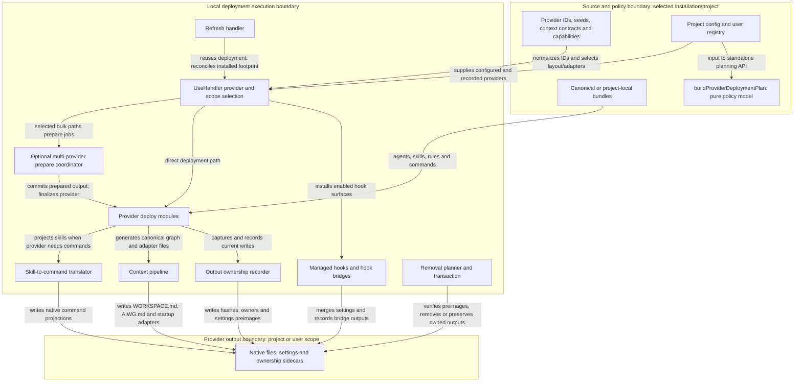

# Provider deployment internals

[Architecture](index.md) · [`use` sequence](flow-use.md)

Provider definitions are the layout authority. `PROVIDER_IDS` orders the registry;
`provider-seeds-1.ts`, `provider-seeds-2.ts` and `provider-seeds-3.ts` supply layouts,
aliases and adapter selectors. `buildDefinition` combines seeds with context
contracts and the capability matrix. The matrix describes native/emulated
features; it does not promise every provider has every output surface.

## Checked provider inventory

The following **20 IDs** are in `PROVIDER_IDS` in 2026.11.x, in registry order:

<!-- provider-ids:start -->
`antigravity`, `claude`, `codex`, `copilot`, `cursor`, `deepseek-harness`, `factory`, `flue`, `grokbot`, `grok-build`, `hermes`, `muse`, `opencode`, `openclaw`, `openhuman`, `pi`, `omp`, `warp`, `devin`, `generic`.
<!-- provider-ids:end -->

`generic` is the fallback layout, not a separate AI harness. Aliases such as
`agy`, `openai`, `oh-my-pi` and `devin` resolve to canonical IDs. The help paths
both call `generateProviderHelp`; their regression test checks every ID and the
count against the registry. To inspect the same source in a built checkout:

```bash
node --input-type=module -e 'import { PROVIDER_IDS } from "./dist/src/providers/provider-definitions.js"; console.log(PROVIDER_IDS.length, PROVIDER_IDS.join(", "))'
```

## Component view



Drawn from:

- [`src/providers/provider-definitions.ts`](../../../src/providers/provider-definitions.ts): `PROVIDER_IDS`, `buildDefinition`, `getProviderDefinition`.
- [`src/providers/provider-seeds-1.ts`](../../../src/providers/provider-seeds-1.ts), [`provider-seeds-2.ts`](../../../src/providers/provider-seeds-2.ts), [`provider-seeds-3.ts`](../../../src/providers/provider-seeds-3.ts): `BUILT_IN_SEEDS_1/2/3`.
- [`src/providers/capability-matrix.ts`](../../../src/providers/capability-matrix.ts): `getProviderCapabilities`.
- [`src/providers/provider-context-contracts.ts`](../../../src/providers/provider-context-contracts.ts): `CONTEXT_CONTRACTS`.
- [`src/cli/provider-deployment-plan.ts`](../../../src/cli/provider-deployment-plan.ts): `buildProviderDeploymentPlan`.
- [`src/cli/handlers/use.ts`](../../../src/cli/handlers/use.ts): `UseHandler.execute`, `executeDeployment`, `deployProjectLocalBundles`.
- [`src/cli/services/provider-prepare-coordinator.ts`](../../../src/cli/services/provider-prepare-coordinator.ts): `prepareProviderDeployments`, `finalizePreparedProvider`.
- [`tools/agents/deploy-agents.mjs`](../../../tools/agents/deploy-agents.mjs): `main`; [`tools/agents/providers/`](../../../tools/agents/providers/): provider deploy adapters.
- [`src/plugin/skill-command-translator.ts`](../../../src/plugin/skill-command-translator.ts): `translateSkillsToCommands`, `generateCommandContent`.
- [`src/smiths/context-pipeline/generator.ts`](../../../src/smiths/context-pipeline/generator.ts): `generate`, `isOverwriteSafe`.
- [`src/smiths/hook-bridge/index.ts`](../../../src/smiths/hook-bridge/index.ts): `bridgeAll`, `TRANSLATORS`.
- [`src/extensions/claude-hooks-installer.ts`](../../../src/extensions/claude-hooks-installer.ts): `installAiwgHooks`.
- [`src/extensions/muse-managed-hooks.ts`](../../../src/extensions/muse-managed-hooks.ts): `managedMuseHooks`.
- [`src/providers/deployment-ownership.mjs`](../../../src/providers/deployment-ownership.mjs): `captureDeploymentOutputs`, `recordDeploymentOutputs`.
- [`src/providers/skill-ownership.mjs`](../../../src/providers/skill-ownership.mjs): `canDeploySkill`, `pruneRecordedSkillFiles`, `releaseSkillOwnership`.
- [`src/cli/handlers/refresh.ts`](../../../src/cli/handlers/refresh.ts): `refreshHandler.execute`, `pruneStaleManagedAgentFiles`.
- [`src/cli/handlers/remove-bundled.ts`](../../../src/cli/handlers/remove-bundled.ts): `removeBundledDeployment`.
- [`src/providers/removal-transaction.ts`](../../../src/providers/removal-transaction.ts): `applyRemovalTransaction`.

## Selection and preparation

`buildProviderDeploymentPlan` models `use`, `refresh` and `update` over project,
global or both scopes. Explicit provider requests win. In use mode the helper
then considers supported/configured providers and defaults to Claude; refresh and
update only plan recorded deployments. Its `upgrade` field describes intended
preflight policy. **The current production handlers do not call this helper**;
`UseHandler` and `refreshHandler` implement actual orchestration. The diagram
therefore shows it as a standalone policy model, not an executed stage.

`UseHandler` normalizes aliases, resolves manifests and scope, and builds deployment
arguments. Canonical bulk paths can prepare provider jobs with concurrency two,
then commit/finalize them. Direct project-local deployment copies that bundle's
artifacts with a project-local owner and reconciles its skill assets. The
[use sequence](flow-use.md) shows both paths.

## Native surfaces, context and hooks

Skills remain canonical content. `translateSkillsToCommands` creates native
command projections where required; providers with native skill loading can
keep skills directly. This does not make those provider commands built-in
`aiwg` subcommands. Paths, agent transforms, model metadata and feature support
come from the selected provider's contracts and deploy adapter.

The context pipeline emits provider-neutral `WORKSPACE.md`, generated `AIWG.md`
and provider startup adapters. It preserves operator-owned regions and checks
whether overwriting files is safe. Do not equate an `AGENTS.md` adapter with a
provider reading every Markdown link automatically.

Claude managed hooks merge settings and retain backups. Muse has its own managed
hook descriptors. The cross-provider bridge uses registered translators (Codex,
Copilot, Factory, Hermes and Grok Build) and explicit installation policy;
unsupported translators return skip reasons. The prompt-discovery path has its
own [latency budget and fail-open contract](flow-prompt-discovery.md).

## Ownership, refresh and removal

Provider `.aiwg-manifest.json` sidecars describe managed outputs. The output
recorder captures prior state and records actual writes, including settings
preimages. Skill ownership resolves collisions by owner and retains peer-owned
files unless an applicable force policy permits replacement. Managed markers
and source/deployed hashes complement receipts; historical config counts alone
do not authorize deletion.

Refresh reuses deployment for the installed footprint and reconciles stale owned
outputs. Removing another provider's tree and deleting tracked outputs require
explicit prune options; ordinary refresh is not a blanket provider-directory wipe.
Project-local deployment records allow refresh to preserve those artifacts.

Bundled removal plans from ownership receipts, checks preimages, then applies the
complete write set through `applyRemovalTransaction`, with private temporary
preimages and rollback on failure. Project-local removal has its own hash/revert
cases in [`project-local-remove.ts`](../../../src/extensions/project-local-remove.ts).
Context writes use `ContextWriteJournal` in
[`context-file-safety.ts`](../../../src/smiths/context-pipeline/context-file-safety.ts).
These are scoped transactions, not an all-or-nothing transaction for every `use`.
